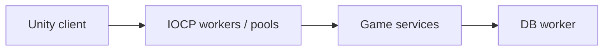

# Arcana Duel — Multiplayer Magic Combat

[English](README.md) · [Korean](README.ko.md) · [Japanese](README.ja.md)

**C++ · IOCP · DB worker · Unity** · 開発記録

[開発事例を見る](https://ysl-ryudo.github.io/ja/work/magicwar/) · [Portfolio](https://ysl-ryudo.github.io/ja/)

**2025.08 - 2026.02 · 2名：プログラマー1名、グラフィック1名**

プログラミング担当：C++サーバー・Unityゲーム連携

C++ IOCPサーバーと連携するUnityマルチプレイヤー魔法戦闘プロジェクトです。

## 取り組んだ課題

マルチプレイヤー魔法戦闘では送受信、再利用する接続リソース、DBを使うゲームサービスが共存します。サーバー内の責務の分け方を示す事例です。

## 担当した実装と設計

IOCPワーカー、セッション・バッファー・Overlappedプール、独立したDBワーカーを構成しました。魔法・クールダウン、試合・プロフィール・ランク、Unityとの連携を担当しました。

### 実装概要 · 概念フロー

### 開発デモ動画

- [Arcana Duel](https://www.youtube.com/watch?v=MJo1y09kzd4)
- [Early development demo](https://www.youtube.com/watch?v=8sKpA2H9Ib4)

撮影時点のプロジェクトデモです。ゲーム内での担当作業は以下の担当範囲で示します。

## 担当した内容

- ゲーム・ネットワーク連携とクライアント側の魔法戦闘システムを担当しました。
- ダメージ・回復、瞬間移動、透明化、バリア、壁、スロー効果が実装され、対応するサービスは別サーバーで処理します。
- ソース履歴に記録されたオーディオ・UIの貢献と外部素材のクレジットを維持しています。

## 貢献の根拠

- [Development history / 개발 이력 / 開発履歴](https://github.com/YSL-RyuDo/magicwar/commits/main/?author=YSL-RyuDo)

コミットは記載した変更の根拠であり、貢献率の点数ではありません。外部素材・チームメンバーの貢献は区別します。

## 実行・コードの確認

[ProjectVersion.txt](ProjectSettings/ProjectVersion.txt)記載のUnity版で開いてください。パッケージロックとシリアライズ済み素材を維持し、Unityを開く前に対象ブランチを選んでください。

- Unity scene: [Assets/Scenes/LoginScene.unity](Assets/Scenes/LoginScene.unity)

[magicwarserver](https://github.com/YSL-RyuDo/magicwarserver)

## 開発・検証範囲

過去の開発状態を整理しています。実装範囲の説明であり、新たなプレイ検証や商用処理容量の結果ではありません。クライアントとサーバーの版を合わせてください。

## 実装の確認方法

IOCP_GameServer.cppと対応するクライアント履歴を併せて確認できます。プールサイズは設定値であり、実測した同時接続数ではありません。
