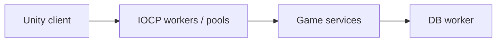

# Arcana Duel — Multiplayer Magic Combat

[English](README.md) · [Korean](README.ko.md) · [Japanese](README.ja.md)

**C++ · IOCP · DB worker · Unity** · 개발 기록

[개발 사례 보기](https://ysl-ryudo.github.io/ko/work/magicwar/) · [Portfolio](https://ysl-ryudo.github.io/ko/)

**2025.08 - 2026.02 · 2명 · 프로그래머 1명, 그래픽 1명**

프로그래밍 담당 · C++ 서버·Unity 게임 연동

C++ IOCP 서버와 연결되는 Unity 멀티플레이 마법 전투 프로젝트입니다.

## 해결하려던 문제

멀티플레이 마법 전투에서는 송수신 처리, 재사용할 연결 자원과 DB를 사용하는 게임 서비스가 함께 동작합니다. 서버에서 각 책임이 어떻게 나뉘는지 보여주는 사례입니다.

## 내 구현과 설계

IOCP 워커, 세션·버퍼·Overlapped 풀과 별도 DB 워커를 구성했습니다. 마법·쿨다운 서비스, 경기·프로필·랭크와 Unity 게임·네트워크 연동을 작업했습니다.

### 구현 개요 · 개념 흐름도

### 개발 시연 영상

- [Arcana Duel](https://www.youtube.com/watch?v=MJo1y09kzd4)
- [Early development demo](https://www.youtube.com/watch?v=8sKpA2H9Ib4)

촬영 당시의 프로젝트 시연입니다. 게임 안에서 제가 맡은 작업은 아래 기여 항목으로 구분합니다.

## 내 기여

- 게임·네트워크 연동과 클라이언트 마법 전투 시스템을 작업했습니다.
- 피해·회복, 순간이동, 투명화, 보호막, 벽과 둔화 효과가 소스에 있으며, 대응하는 게임 서비스는 별도 서버에서 처리합니다.
- 소스 이력에 남아 있는 오디오·UI 기여와 외부 에셋의 원래 크레딧을 유지합니다.

## 기여 근거

- [Development history / 개발 이력 / 開発履歴](https://github.com/YSL-RyuDo/magicwar/commits/main/?author=YSL-RyuDo)

커밋은 설명한 변경의 근거이며 기여율 점수가 아닙니다. 외부 에셋과 팀원 작업의 크레딧은 구분합니다.

## 실행·코드 확인

[ProjectVersion.txt](ProjectSettings/ProjectVersion.txt)의 Unity 버전으로 프로젝트를 여세요. 패키지 잠금 파일과 직렬화된 에셋을 유지하고, Unity를 열기 전에 문서에서 설명한 브랜치를 선택하세요.

- Unity scene: [Assets/Scenes/LoginScene.unity](Assets/Scenes/LoginScene.unity)

[magicwarserver](https://github.com/YSL-RyuDo/magicwarserver)

## 개발·검증 범위

과거 개발 상태를 정리합니다. 문서는 구현 범위를 설명하며, 새 플레이 테스트나 상용 수용량 검증 결과가 아닙니다. 클라이언트와 서버 버전을 맞춰 사용하세요.

## 구현을 확인하는 방법

IOCP_GameServer.cpp와 대응 클라이언트 이력을 함께 확인할 수 있습니다. 풀 크기는 설정값이며 측정된 동시 접속 수는 아닙니다.
