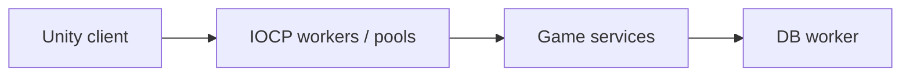

# Arcana Duel — Multiplayer Magic Combat

[English](README.md) · [Korean](README.ko.md) · [Japanese](README.ja.md)

**C++ · IOCP · DB worker · Unity** · Development archive

[Explore the case](https://ysl-ryudo.github.io/en/work/magicwar/) · [Portfolio](https://ysl-ryudo.github.io/en/)

**Aug 2025 - Feb 2026 · 2 members: 1 programmer, 1 graphics**

Programming: C++ server & Unity game integration

A Unity multiplayer magic-combat project paired with a C++ IOCP server.

## The engineering problem

Multiplayer magic combat combines receive/send handling, reusable connection resources and database-backed game services. Those responsibilities should be readable as separate parts of the server.

## My implementation

The server uses IOCP workers, session/buffer/overlapped pools and a separate DB worker. My work includes magic/cooldown services, matches, profiles and ranks, with Unity-side game/network integration.

### Implementation overview · conceptual flow

### Development videos

- [Arcana Duel](https://www.youtube.com/watch?v=MJo1y09kzd4)
- [Early development demo](https://www.youtube.com/watch?v=8sKpA2H9Ib4)

Recorded project demonstrations; the contribution section below identifies my work within the game.

## My contribution

- Worked on the game/network integration and the client-side magic-combat systems.
- The source includes damage/heal, blink, invisibility, barriers, walls and slow effects; the companion server handles the corresponding game services.
- Original audio/UI contributions recorded in source history and third-party asset credits are retained.

## Contribution evidence

- [Development history / 개발 이력 / 開発履歴](https://github.com/YSL-RyuDo/magicwar/commits/main/?author=YSL-RyuDo)

Commits are evidence of the stated changes, not a percentage-of-authorship score. Third-party assets and teammates' work remain separately credited.

## Open and inspect

Open the project with the Unity version recorded in [ProjectVersion.txt](ProjectSettings/ProjectVersion.txt). Keep its package lock and serialized assets intact. Select the documented branch before opening Unity.

- Unity scene: [Assets/Scenes/LoginScene.unity](Assets/Scenes/LoginScene.unity)

[magicwarserver](https://github.com/YSL-RyuDo/magicwarserver)

## Development and verification scope

Historical development snapshot. The documentation identifies implementation areas, not a new gameplay test or a production-capacity result. Use the client and server as a matched pair.

## How to evaluate the work

Inspect IOCP_GameServer.cpp and the companion client history. Pool sizes are configuration values, not measured concurrency capacity.
